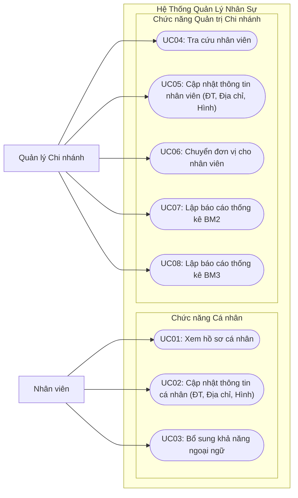
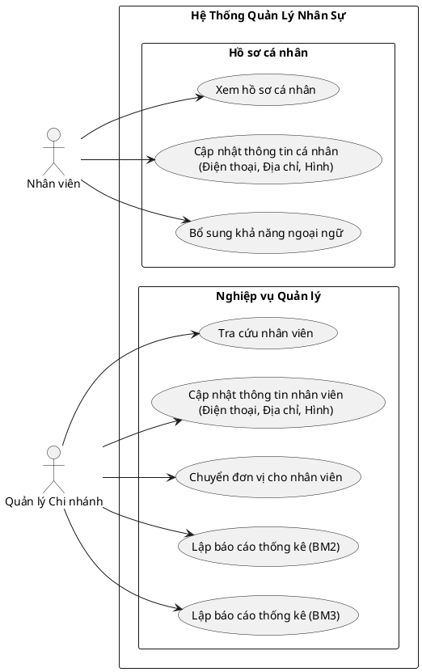

# TÀI LIỆU PHÂN TÍCH USE CASE - HỆ THỐNG QUẢN LÝ NHÂN SỰ

---

## 1. Xác Định Actors & Phân Rã Chức Năng

### 1.1. Tác nhân (Actors)
* **Nhân viên (Employee):** Người dùng nội bộ thao tác trên dữ liệu cá nhân của chính mình.
* **Quản lý Chi nhánh (Branch Manager):** Cán bộ phụ trách quản lý nhân sự thuộc đơn vị, điều chuyển nhân sự và kết xuất các biểu mẫu báo cáo.

### 1.2. Danh sách Use Cases

| Mã UC | Tên Use Case | Tác nhân chính | Mô tả chức năng |
| :--- | :--- | :--- | :--- |
| **UC01** | Xem hồ sơ cá nhân | Nhân viên | Cho phép nhân viên xem thông tin hồ sơ của chính mình |
| **UC02** | Cập nhật thông tin cá nhân | Nhân viên | Cho phép sửa số điện thoại, địa chỉ và ảnh đại diện của bản thân |
| **UC03** | Bổ sung khả năng ngoại ngữ | Nhân viên | Thêm thông tin trình độ/chứng chỉ ngoại ngữ mới |
| **UC04** | Tra cứu nhân viên | Quản lý Chi nhánh | Tìm kiếm, lọc và xem thông tin nhân sự trong chi nhánh |
| **UC05** | Cập nhật thông tin nhân viên | Quản lý Chi nhánh | Cập nhật số điện thoại, địa chỉ, ảnh đại diện của nhân viên |
| **UC06** | Chuyển đơn vị cho nhân viên | Quản lý Chi nhánh | Điều chuyển nhân viên sang bộ phận hoặc đơn vị công tác mới |
| **UC07** | Lập báo cáo thống kê BM2 | Quản lý Chi nhánh | Tạo và xuất biểu mẫu thống kê BM2 |
| **UC08** | Lập báo cáo thống kê BM3 | Quản lý Chi nhánh | Tạo và xuất biểu mẫu thống kê BM3 |

---

## 2. Sơ Đồ Use Case (Mermaid)

---

## 3. Sơ Đồ Use Case Chuẩn PlantUML (Tùy chọn)

