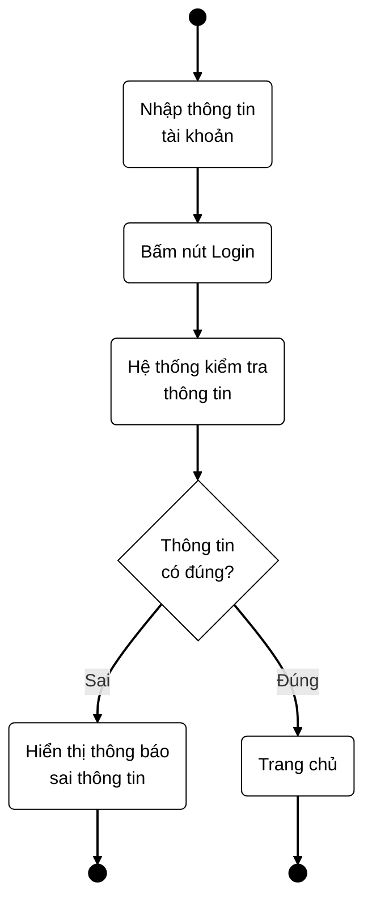

# Sơ đồ Use Case - Hệ thống đăng nhập

## 1. Prompt nhờ AI hướng dẫn vẽ

Bạn là chuyên gia phân tích và thiết kế hệ thống UML.
Hãy hướng dẫn tôi vẽ sơ đồ Use Case cho chức năng đăng nhập
hệ thống bằng Mermaid.

Yêu cầu:
- Có tác nhân Người dùng.
- Có biên hệ thống Đăng nhập.
- Có use case Nhập thông tin tài khoản.
- Có use case Xác thực thông tin.
- Có use case Thông báo lỗi đăng nhập.
- Có quan hệ giữa tác nhân và các chức năng.
- Sơ đồ sử dụng màu đen trắng, đường nối màu đen.
- Viết mã Mermaid hoàn chỉnh, có thể render trong VS Code
  hoặc Antigravity IDE.
- Hướng dẫn cách lưu file Markdown và cài extension để xem sơ đồ.

## 2. Mã Mermaid vẽ Use Case

# Sơ đồ Activity đăng nhập

## 3. Cách mở và render sơ đồ

1. Lưu nội dung này thành file `usecase.md`.
2. Mở file bằng VS Code hoặc Antigravity IDE.
3. Cài extension `Markdown Preview Mermaid Support`.
4. Nhấn `Ctrl + Shift + V` để xem sơ đồ Use Case.

## 4. Kết quả

Sơ đồ mô tả tác nhân Người dùng tương tác với chức năng
đăng nhập, xác thực thông tin, thông báo lỗi và truy cập
trang chủ.

Màu sắc của sơ đồ là đen trắng, đường nối màu đen.
