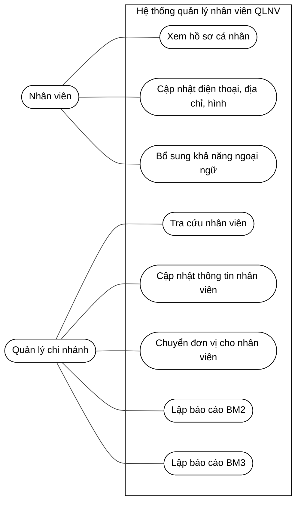

# BÀI TẬP: QUẢN LÝ NHÂN VIÊN (QLNV_0)

## 1. Prompt sử dụng AI

Hãy phân tích yêu cầu của hệ thống Quản lý nhân viên QLNV_0 và hướng dẫn vẽ sơ đồ Use Case bằng Mermaid.

Bối cảnh:
- Công ty X có 2 chi nhánh.
- Chi nhánh A có 2 đơn vị A1, A2.
- Chi nhánh B có 4 đơn vị B1, B2, B3, B4.
- Mỗi đơn vị có trung bình 25 nhân viên.
- Thông tin nhân viên được quản lý theo biểu mẫu BM1.

Các chức năng của Nhân viên:
- Xem hồ sơ của chính mình.
- Cập nhật điện thoại, địa chỉ và hình.
- Bổ sung khả năng ngoại ngữ.

Các chức năng của Quản lý chi nhánh:
- Tra cứu nhân viên.
- Cập nhật điện thoại, địa chỉ và hình của nhân viên.
- Chuyển đơn vị cho nhân viên.
- Lập báo cáo thống kê BM2 và BM3.

Yêu cầu dữ liệu BM1:
- Họ tên, CMND, điện thoại, email và địa chỉ không được để trống.
- Tuổi nhân viên từ 18 đến 50.
- Mức lương tối thiểu là 7.500.000.
- Nhân viên phải biết sử dụng ít nhất một ngoại ngữ trong các ngôn ngữ: Anh, Pháp, Nga, Đức, Brasil.

Báo cáo:
- BM2: Thống kê số nhân viên theo đơn vị và tỷ lệ phần trăm.
- BM3: Thống kê số nhân viên theo ngoại ngữ và tỷ lệ phần trăm.
- Tỷ lệ = Số nhân viên thuộc nhóm * 100 / Tổng số nhân viên.

Hãy xác định các tác nhân, các ca sử dụng, quan hệ giữa tác nhân và ca sử dụng, sau đó tạo sơ đồ Use Case bằng Mermaid. Sơ đồ phải có màu đen trắng, dễ đọc và có ranh giới hệ thống.

## 2. Phân tích tác nhân

- Nhân viên: xem hồ sơ của chính mình, cập nhật thông tin cá nhân và bổ sung ngoại ngữ.
- Quản lý chi nhánh: tra cứu nhân viên, cập nhật thông tin nhân viên, chuyển nhân viên sang đơn vị khác và lập báo cáo thống kê.

## 3. Sơ đồ Use Case

# Sơ đồ Use Case – Quản lý nhân viên

## 4. Mô tả các ca sử dụng

### UC1 – Đăng nhập hệ thống
Người dùng đăng nhập để sử dụng chức năng phù hợp với quyền hạn của mình.

### UC2 – Xem hồ sơ cá nhân
Nhân viên xem thông tin cá nhân theo biểu mẫu BM1, bao gồm họ tên, CMND, giới tính, ngày sinh, mức lương, điện thoại, email, địa chỉ, đơn vị và khả năng ngoại ngữ.

### UC3 – Cập nhật điện thoại
Nhân viên cập nhật số điện thoại của chính mình. Quản lý chi nhánh có thể cập nhật điện thoại của nhân viên.

### UC4 – Cập nhật địa chỉ
Cho phép cập nhật địa chỉ nhân viên và lưu thông tin mới vào hồ sơ.

### UC5 – Cập nhật hình cá nhân
Cho phép cập nhật hình ảnh của nhân viên.

### UC6 – Bổ sung khả năng ngoại ngữ
Nhân viên bổ sung các ngoại ngữ mà mình có thể sử dụng. Nhân viên phải biết ít nhất một ngoại ngữ theo yêu cầu.

### UC7 – Tra cứu nhân viên
Quản lý chi nhánh tìm kiếm nhân viên để xem hoặc cập nhật thông tin.

### UC8 – Xem hồ sơ nhân viên
Hiển thị thông tin của nhân viên được chọn theo biểu mẫu BM1.

### UC9 – Cập nhật thông tin nhân viên
Quản lý chi nhánh cập nhật thông tin được phép chỉnh sửa và kiểm tra các điều kiện dữ liệu.

### UC10 – Chuyển đơn vị cho nhân viên
Quản lý chi nhánh thay đổi đơn vị làm việc của nhân viên trong cơ cấu tổ chức.

### UC11 – Lập báo cáo BM2
Thống kê số lượng nhân viên theo từng đơn vị và tính tỷ lệ trên tổng số nhân viên.

### UC14 – Lập báo cáo BM3
Thống kê số lượng nhân viên theo từng ngoại ngữ và tính tỷ lệ trên tổng số nhân viên.

## 5. Cách mở sơ đồ trong VS Code

1. Tạo file `usecase.md`.
2. Sao chép toàn bộ nội dung ở trên vào file.
3. Cài extension **Markdown Preview Mermaid Support**.
4. Lưu file bằng `Ctrl + S`.
5. Nhấn `Ctrl + Shift + V` để mở Markdown Preview.

Lưu ý: Sơ đồ trên dùng Mermaid `flowchart` để mô phỏng Use Case. Nếu giảng viên yêu cầu chuẩn UML tuyệt đối, nên chuyển sang PlantUML hoặc công cụ UML chuyên dụng; các điều kiện tuổi, lương và ngoại ngữ là quy tắc nghiệp vụ, không nhất thiết phải tách thành các Use Case riêng.
